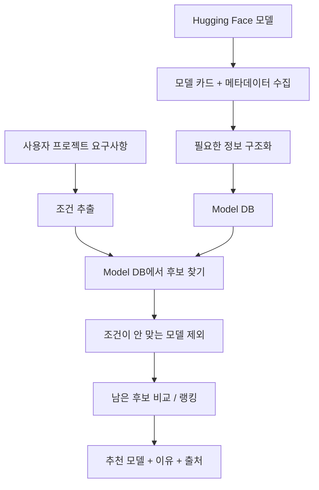

# 👾 Model Scout

프로젝트 요구사항을 자연어로 입력하면, 한국어 지원·라이선스·실행 환경 등 프로젝트 조건에 맞는 오픈 모델을 근거와 함께 추천하는 도구

---

## 1. 해결하려는 문제

Hugging Face에는 수많은 모델이 있지만, 실제 프로젝트에 맞는 모델을 고르려면 여러 정보를 직접 확인해야 한다.

- **태그만 보고 판단하기 어렵다** → 언어, 라이선스, 권장 용도 등이 모델 카드 본문에 따로 적혀 있는 경우가 있다.
- **중요한 정보가 흩어져 있다** → 학습 데이터, 한계, 사용 방법, 성능 설명이 모델마다 다른 형식으로 작성되어 있다.
- **실행 가능한 모델인지 바로 알기 어렵다** → 모델 크기뿐 아니라 정밀도, 양자화, 실행 환경을 함께 봐야 한다.
- **내 프로젝트 기준으로 비교하기 어렵다** → 다운로드 수가 높다고 해서 내 조건에 가장 적합한 모델이라는 뜻은 아니다.

사람이 여러 모델 카드를 열어보고 비교하던 과정을 줄이고, **조건을 만족하는 후보와 추천 이유를 빠르게 확인할 수 있게 한다.**

## 2. 누구를 위한 도구인가

프로젝트에 넣을 오픈 모델을 직접 선정해야 하는 개발자 / ML 엔지니어. 이런 상황을 우선 대상으로 한다.

- 한국어 데이터를 다룬다.
- 외부 API보다 로컬 / 사내 환경에서 모델을 실행하고 싶다.
- 사용할 수 있는 하드웨어나 메모리 조건이 정해져 있다.
- 상업적 이용 가능 여부가 중요하다.
- 인기 모델이 아니라 **내 조건을 통과하는 모델**이 필요하다.

> 핵심은 "좋은 모델을 알려주는 서비스"가 아니라 **"내 프로젝트에 적합한 모델을 골라주는 서비스"** 이다.

## 3. 프로젝트 범위

**우선 다룰 범위**

- 언어 — 한국어 + 한국어를 지원하는 다국어 모델
- Task — 임베딩, 텍스트 분류, 요약, 개체명 인식, 텍스트 생성 중 우선순위를 정해 시작
- 실행 환경 — 로컬 또는 사내 환경에서 실행하는 상황을 고려
- 라이선스 — 상업적 이용 가능 여부 등 사용 조건 확인
- 모델 정보 — Hugging Face 메타데이터 + 모델 카드(README)

**아직 숫자로 고정하지 않을 것**

GPU / VRAM 기준, 최대 모델 크기, 전체 수집 모델 수, 지원할 Task 개수. 이 값들은 처음부터 임의로 정하기보다 **실제 모델 몇 개를 먼저 조사한 뒤 데이터 분포를 보고 확정**한다.

**하지 않는 것**

파인튜닝 / 자체 모델 학습, 모든 언어와 모든 Task 지원, 자체 벤치마크 리더보드 구축, 복잡한 프론트엔드.

**확장 기능**

아래 두 가지는 핵심 추천 파이프라인이 완성된 뒤에 구현한다.

- **신규 모델 모니터링 / 알림** — 프로젝트 조건을 저장해두면, 이후 새로 올라온 모델 중 그 조건을 통과하면서 기존 추천보다 나은 후보가 나타났을 때 알려준다. 일회성 추천을 넘어 계속 지켜봐주는 역할이 된다. Hugging Face 트렌딩과 다른 점은 인기 순위가 아니라 **내 프로젝트 조건 기준**으로 판단한다는 것. 새로 만드는 기능이라기보다 기존 추천 파이프라인을 주기적으로 다시 실행하는 것에 가깝다. 구독 저장, 증분 수집 스케줄러, 결과 비교, 알림 채널만 추가하면 되고 **추천 로직 자체는 손대지 않는다.**
- **후보 모델 직접 실행 비교** — 추천된 상위 후보를 실제로 실행해 속도·메모리·출력을 비교한다. 추천에서 검증으로 넘어가는 단계이며, 모델 크기 상한이나 실행 시간 제한 같은 통제 조건이 필요하다.

모니터링을 나중에 쉽게 붙이려면 처음부터 지켜야 할 것이 있다. 지금은 공짜지만 나중에 고치려면 비싼 것들이다.

1. **조건 추출 결과를 저장 가능한 구조로 남긴다.** 사용자 문장을 프롬프트에 그대로 흘려보내지 말고 `{task, 언어, 라이선스, 실행환경}` 형태로 뽑아 저장한다. 이것이 나중에 그대로 구독 조건이 된다.
2. **추천을 독립 함수로 분리한다.** `추천(조건) → 결과` 형태여야 사람도 스케줄러도 같은 함수를 호출할 수 있다.
3. **모델 DB에 최초 수집 시점 필드를 둔다.** 신규 모델 감지의 근거가 된다.
4. **추천 결과를 점수와 함께 저장한다.** 나중에 결과가 달라졌는지 비교할 기준선이 된다.

## 4. 시스템 동작 순서

Hugging Face의 모델을 미리 읽고 정리해둔 뒤 → 사용자가 프로젝트 조건을 입력하면 → 정리된 모델 중 조건에 맞는 후보를 골라준다.



### ① 모델 정보를 미리 정리한다

Hugging Face에서 모델을 수집하고, 모델 카드와 메타데이터를 읽어 검색하기 쉬운 형태로 정리한다. 모델 카드처럼 형식이 일정하지 않은 문서는 LLM을 이용해 구조화하고, 최종 결과는 정해진 스키마로 저장한다.

저장할 정보는 Task / 언어 / 파라미터 수 / 모델 파일 크기 / 라이선스 및 추가 사용 조건 / 학습 데이터 / 권장 용도 / 제한사항 / 최근 업데이트 / 다운로드 수 등 참고 지표, 그리고 **정보의 출처가 된 모델 카드 위치**다.

모든 정보를 미리 저장하지는 않는다. 정보의 성격에 따라 나눈다.

- **미리 구축** — 모델 카드 파싱 결과, 임베딩 → 잘 바뀌지 않고 처리 비용이 크다.
- **조회 시점에 API 확인** — 다운로드 수, 최근 업데이트, 모델 존재 여부 → 자주 바뀌고 확인이 가벼운 값이다.
- **실시간 검색으로 폴백** — DB에서 후보가 충분히 나오지 않으면 그때 Hugging Face를 직접 검색해 즉석 파싱한다 → DB 최신성을 보완한다.

**왜 매번 검색하지 않고 미리 정리해두는가**

- Hugging Face API 검색은 태그와 이름 기반이다. 매번 검색만으로 후보를 뽑으면, 태그가 부실해서 모델을 찾기 어렵다는 우리 문제를 후보 선정 단계에서 그대로 반복하게 된다. 의미 기반으로 후보를 찾으려면 모델 카드를 미리 임베딩해두어야 한다.
- 요청마다 후보 README를 파싱하면 응답이 느리고 비용이 커진다.
- 후보 모수가 매번 달라지면 추천 품질이 나아졌는지 평가할 수 없다.
- 어떤 모델이 왜 제외되었는지 보여주려면, 우리가 알고 있는 전체 후보가 있어야 한다.

### ② 사용자의 조건에 맞는 모델을 찾는다

사용자가 자연어로 프로젝트 상황을 입력하면 필요한 조건을 추출한 뒤 Model DB에서 후보를 찾는다.

> 쇼핑몰 리뷰 감성분석 / 한국어 / 상업적 이용 필요 / 로컬 환경에서 실행 / 추가 학습 없이 사용

| 입력에서 추출할 것 | 예시 |
| --- | --- |
| Task | 텍스트 분류 |
| 언어 | 한국어 |
| 라이선스 조건 | 상업적 이용 가능 |
| 실행 환경 | 로컬 |
| 추가 학습 여부 | 바로 사용 |

이 조건을 기준으로:

1. 관련 모델 후보를 찾는다.
2. 반드시 지켜야 하는 조건을 통과하지 못한 모델은 제외한다.
3. 남은 모델을 프로젝트 적합도 기준으로 비교한다.
4. 상위 후보와 추천 이유, 주의사항, 출처를 보여준다.

추천 모델만 보여주는 것이 아니라, 필요하면 **왜 다른 후보가 제외되었는지**도 함께 보여준다.

- model-B → 상업적 이용 조건 확인 필요
- model-C → 한국어 지원 근거 부족
- model-D → 입력한 실행 환경 조건 초과

## 5. 설계 원칙

**LLM은 '읽고 이해하는 일'에 사용하고, 명확하게 판정할 수 있는 조건은 코드로 처리한다.**

| LLM | 규칙 기반 코드 |
| --- | --- |
| 사용자 요구사항 해석 | 필수 조건 통과 여부 확인 |
| 모델 카드의 비정형 정보 구조화 | 모델 크기 / 실행 조건 계산 |
| 라이선스 문구에서 조건 추출 | 정의된 라이선스 정책과 비교 |
| 추천 이유를 읽기 쉽게 설명 | 점수 계산 / 정렬 / 제외 처리 |

중요한 원칙은 **조건을 위반한 모델을 점수로 살려내지 않는 것**이다. 예를 들어 상업적 이용이 반드시 필요하다면, 해당 조건을 충족하지 못한 모델은 다운로드 수나 인기가 높아도 추천 후보에서 제외한다.

## 6. 기술 구성

아직 기술을 먼저 확정하기보다, 작은 데이터로 파이프라인을 만든 뒤 필요한 기술을 결정한다.

| 영역 | 현재 후보 |
| --- | --- |
| 요구사항 해석 | LLM API 또는 소형 로컬 모델 |
| 모델 카드 구조화 | LLM 배치 처리 |
| 모델 검색 | 메타데이터 필터 + 벡터 검색 |
| 임베딩 모델 | BGE-M3 등 후보 비교 후 결정 |
| 데이터 저장 | Supabase PostgreSQL + pgvector (`model_scout_models`) |
| 백엔드 | FastAPI |
| UI | Streamlit |

## 7. 진행 순서

### 파이프라인 스크립트 구성

실행 순서는 `08_sync_supabase.py`가 관리한다. 각 단계는 비용과 재시작 경계가 달라 독립 실행 파일로 유지하고, 중복 구현만 합친다.

| 단계 | 정식 담당 | 역할 |
| --- | --- | --- |
| 1 | `01_collect_models.py` | Hugging Face 모델 수집 및 9개 pipeline tag 후보화 |
| 2 | `02_enrich_metadata.py` | 메타데이터·README 출처 정규화 |
| 3 | `03_generate_semantic_metadata.py` | README 근거 기반 의미 메타데이터 생성 |
| 보조 | `03_repair_truncated_semantic.py`, `evidence_index.py` | Stage 3 복구 및 근거 parent/child 인덱스 |
| 4 | `04_build_embeddings.py` | 임베딩 생성·로컬/Supabase 캐시 재사용 |
| 보조 | `06_extract_benchmark_metadata.py` | 벤치마크 추출과 Stage 4 compact 통합을 한 번에 수행 |
| 동기화 | `08_sync_supabase.py` | 검증·스키마·증분/초기 Supabase 적재 |
| 검증 | `05_validate_retrieval.py` | 검색·근거·필터 회귀 검증 |

`07_integrate_benchmark_metadata.py`는 기존 수동 호출 호환용 래퍼이며 새 파이프라인에서는 직접 호출하지 않는다. 벤치마크 원본 sidecar는 재생성 가능한 중간 산출물로 보관하지 않고, Stage 4에는 검색·랭킹에 필요한 compact projection만 남긴다.

전체 기능을 한 번에 만들지 않고, **작게 확인 → 한 번 연결 → 확장** 순서로 진행한다.

### Step 1. 직접 모델을 찾아본다

각자 실제 프로젝트 요구사항을 몇 개씩 만든다. (한국어 리뷰 분류 / 한국어 문서 임베딩 / 한국어 요약 / 작은 생성 모델 등)

직접 Hugging Face에서 모델을 찾으면서 다음을 기록한다.

- 어떤 검색어를 사용했는지
- 어떤 정보를 확인했는지
- 후보를 왜 제외했는지
- 최종적으로 어떤 모델을 골랐는지
- 얼마나 시간이 걸렸는지

**목적** — 우리가 자동화해야 하는 판단 기준을 먼저 찾는다.

### Step 2. 모델 몇 개만 우선 수집해본다

전체 데이터를 긁기 전에 작은 샘플로 확인한다.

- 어떤 필드는 API에서 바로 얻을 수 있는가?
- 어떤 정보는 README를 읽어야 하는가?
- 언어 / 라이선스 / Task 정보가 얼마나 잘 채워져 있는가?
- 어떤 스키마로 저장해야 검색하기 좋은가?

**결과** — Model DB에 들어갈 필드와 파싱 기준을 확정한다.

**함께 수집할 것: 이상 사례**

스키마를 정하는 것과 별개로, 모델 카드가 실제로 얼마나 부실한지를 사례로 모으고 각 유형이 몇 건인지 세어둔다.

- 라이선스 태그와 본문의 실제 사용 조건이 다른 모델
- 한국어를 지원하는데 언어 태그가 없는 모델
- Task 태그와 실제 권장 용도가 다른 모델
- README가 비어 있거나 템플릿 그대로인 모델
- 파라미터 수나 모델 크기를 알 수 없는 모델

**왜 세는가** — 이 숫자가 "왜 이 프로젝트가 필요한가"의 증거가 된다. 태그 필터만으로 충분하다면 이 도구는 필요 없다.

### Step 3. 추천 규칙을 먼저 만든다

LLM 추천부터 만들지 않고, 명확한 조건부터 코드로 정의한다.

```text
언어 조건 통과?
라이선스 조건 통과?
Task가 맞는가?
실행 환경 조건을 만족하는가?
정보의 근거가 충분한가?
```

**결과** — 어떤 모델을 반드시 제외해야 하는지 설명할 수 있게 된다.

### Step 4. 요구사항 하나로 끝까지 연결한다

처음에는 모든 Task를 지원하려 하지 않는다. 예를 들어 `한국어 텍스트 분류 모델 추천` 하나만 골라서:

```text
사용자 입력 → 조건 추출 → 후보 검색 → 필터링 → 랭킹 → 추천 결과
```

이 흐름이 실제로 한 번 끝까지 동작하게 만든다.

**결과** — 서비스의 핵심 구조가 맞는지 빠르게 확인할 수 있다.

### Step 5. 테스트 케이스를 늘리고 평가한다

Step 1에서 만든 요구사항들을 다시 시스템에 넣어본다.

- 사람이 고른 후보와 얼마나 비슷한가?
- 조건을 위반한 모델이 추천되지는 않는가?
- 추천 이유에 실제 근거가 있는가?
- 어떤 상황에서 검색 결과가 좋지 않은가?

실패 사례를 확인한 뒤 Task와 데이터 규모를 확장한다.

> 사람이 직접 해보기 → 1차 모델 조사 → 필터 기준 정의 → 한 케이스 End-to-End → 테스트 케이스 확대

## Supabase 운영 명령

스키마 DDL은 데이터 동기화와 분리되어 있다. 최초 설치 또는 스키마 변경 때만 실행한다.

```bash
python 08_sync_supabase.py --ensure-schema
python 08_sync_supabase.py --initial --apply
```

이후에는 TTL이 적용된 증분 동기화를 실행한다.

```bash
python 08_sync_supabase.py --refresh --apply
```

증분 갱신은 변경된 모델과 변경된 벤치마크 메타데이터만 Stage 4와 Supabase에 반영한다. 전체 재조정이 필요한 경우에만 전체 임베딩 경로를 사용한다. 현재 운영 수집 범위는 9개 pipeline tag 기준이다.

벤치마크 원본 sidecar는 커밋하지 않고, 변경 감지용 소형 fingerprint 상태만 성공한 sync 뒤에 저장한다.

## 8. 성공 기준

**반드시 지켜야 하는 것**

- 필수 조건을 위반한 모델을 추천하지 않는다.
- 추천마다 **왜 추천했는지 확인할 수 있는 근거**가 있다.
- 정보가 부족하면 확정적으로 말하지 않고 `확인 필요`로 구분한다.

**측정할 것**

- 모델 카드에서 필요한 정보를 얼마나 정확하게 추출하는가
- 추천 상위 후보가 사람이 판단한 적합 후보와 얼마나 겹치는가
- 사람이 직접 찾을 때보다 탐색 시간이 얼마나 줄어드는가
- 조건 위반 / 잘못된 라이선스 판정 같은 치명적 오류가 얼마나 발생하는가

구체적인 목표 수치는 테스트 데이터를 만든 뒤 정한다.
