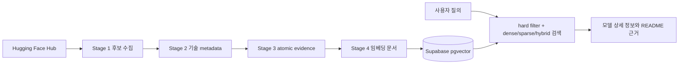

# Model Scout

자연어로 입력한 프로젝트 요구사항을 기준으로 Hugging Face 모델을 검색하고, 조건을 통과한 후보와 추천 근거를 함께 제공하는 데이터 파이프라인입니다. 한국어 지원 여부, task, 라이선스, 파라미터 수, context length, 양자화, 실행 환경, 모델 카드 근거를 하나의 검색 corpus로 결합합니다.

## 현재 상태

이 문서의 수량은 2026-09-28 현재 snapshot 기준입니다.

- Stage 1~4 데이터 생성과 검증을 완료했습니다.
- 실제 추천 corpus는 Core 1,478개와 Low Popularity 2,128개, 총 3,606개입니다.
- Likely와 Fallback은 참고용 Stage 1 후보이며 Stage 2~4와 추천 검색 corpus에는 포함하지 않습니다.
- Supabase에는 모델 검색 테이블과 Parent–Child evidence 테이블을 적재합니다.
- Stage 4 임베딩은 `text-embedding-3-small`, 1,536차원이며 현재 Supabase `pgvector`가 정식 검색 저장소입니다.
- 데이터가 부족하거나 출처가 없는 값은 `null`, `unknown`, `no_source`로 보존합니다. 알 수 없는 값을 0이나 확정적인 문장으로 바꾸지 않습니다.

## 범위와 후보 정책

현재 수집 task는 다음 9개 pipeline tag입니다.

`text-generation`, `feature-extraction`, `sentence-similarity`, `text-classification`, `question-answering`, `summarization`, `translation`, `image-text-to-text`, `automatic-speech-recognition`

Stage 1은 Hugging Face Hub의 구조화된 metadata와 결정론적 규칙만 사용합니다.

| tier | candidate type | 의미 |
|---|---|---|
| `A_verified` | `korean_explicit` | 언어 metadata에 정규화된 `ko`가 있음 |
| `A_verified` | `korean_translation_pair` | `ko-en`, `en-ko`, `ja-ko` 등의 명시적 번역 pair |
| `A_verified` | `korean_name_strong` | KoBERT, KLUE 등 보수적인 한국어 모델명 근거 |
| `B_likely` | `multilingual_explicit` / `multilingual_tag_only` | 다국어 표시는 있지만 한국어를 확정하지 못함 |
| `C_fallback` | `family_heuristic` | 알려진 다국어 계열명만 일치함 |

다국어 표시는 한국어 지원을 보증하지 않습니다. Core와 Low Popularity에는 `A_verified`만 넣고, 이름 기반 판정은 metadata 기반 판정보다 약한 근거로 별도 보존합니다. 다운로드 수는 모델 품질 점수가 아니라 오프라인 후보 우선순위입니다.

## 파이프라인



| 단계 | 스크립트 | 결과 |
|---|---|---|
| 1 | `01_collect_models.py` | 9개 task의 한국어 후보, tier, canonical/variant grouping |
| 2 | `02_enrich_metadata.py` | config, tokenizer, artifact, license, runtime, parameter/context metadata |
| 3 | `03_generate_semantic_metadata.py` | README 기반 요약, 장점, 제한사항, use case, claim별 evidence |
| 3 보조 | `03_repair_truncated_semantic.py`, `evidence_index.py` | 긴 README 복구와 Parent–Child evidence index |
| 4 | `04_build_embeddings.py` | 검색용 `embedding_text`와 1,536차원 임베딩 |
| 벤치마크 | `06_extract_benchmark_metadata.py` | README/model-index benchmark의 보수적 projection |
| 동기화 | `08_sync_supabase.py` | 검증, 초기 적재, 증분 TTL sync, evidence backfill |
| 검증 | `05_validate_retrieval.py` | 검색·근거·필터 회귀 검증 |

`07_integrate_benchmark_metadata.py`는 이전 수동 실행과의 호환용 래퍼입니다. 일반적인 전체·증분 파이프라인에서는 `06_extract_benchmark_metadata.py`를 사용합니다.

### Stage 1: 후보 수집

설정은 `MIN_DOWNLOADS=80`, `CORE_DOWNLOADS=500`, `LIMIT_PER_TASK=None`, `CUTOFF_CONFIRMATION=10`입니다. 각 task의 API 응답이 비어 있거나 cutoff 검증에 실패하면 기존 snapshot을 유지하도록 fail-closed로 동작합니다. 증분 sync에서는 마지막 watermark 이후 변경된 모델만 다음 단계로 전달합니다.

현재 Stage 1 파일은 [data/README.md](data/README.md)의 표를 기준으로 관리합니다.

### Stage 2: 기술 metadata

LLM을 사용하지 않고 Hub metadata, config, tokenizer config, artifact index, README와 model card metadata를 결합합니다. `parameter_count`와 `context_length`는 출처를 보존하며, 확인되지 않으면 `null`입니다.

`runtime_compatibility`는 CPU, CUDA, MPS, vLLM, ONNX, llama.cpp에 대해 README와 artifact에서 확인한 보조 신호입니다. `documented` 또는 `artifact_present`가 가장 강한 상태이며, `inferred`, `mentioned`, `unknown`은 실제 실행 성공을 뜻하지 않습니다.

### Stage 3: atomic evidence

저비용 LLM이 README를 section-aware atomic span으로 나누고, semantic claim마다 `evidence_refs`와 `supporting_quote`를 붙입니다. Parent는 README section, Child는 claim을 가리키며 관계는 별도 sidecar와 Supabase `model_scout_evidence`에 저장합니다.

현재 README snapshot 기준으로 Core 1,474개, Low Popularity 2,122개를 확보했습니다. 긴 README 41개(Core), 84개(Low)를 별도로 보강했으며, 원본 snapshot에서 잘림이 남은 모델은 Core 7개, Low 12개입니다. README 자체가 없는 모델은 Core 4개, Low 6개이고 metadata-only로 보존합니다.

### Stage 4: 검색 문서와 임베딩

모델별 검색 문서는 identity, task, 언어, 기술 metadata, runtime, popularity, Stage 3 semantic summary/claims, benchmark projection을 포함합니다. Stage 4는 Core와 Low Popularity만 대상으로 하며, `--execute`일 때만 임베딩 API를 호출합니다. 기본 실행은 dry-run입니다.

Stage 4는 모델당 하나의 dense vector를 저장합니다. Parent–Child text를 별도 dense index로 중복 임베딩하지 않고, 먼저 모델 후보를 검색한 뒤 후보 내부에서 evidence를 재랭킹하고 Parent section과 원문 quote를 hydrate합니다.

## Benchmark metadata

README의 benchmark 표와 `model-index` 수치는 보조 순위 신호로만 사용합니다.

- 숫자 없이 benchmark 이름만 있으면 `mentions`로 보존합니다.
- 모델명과 점수의 연결이 불명확하면 ranking에 사용하지 않습니다.
- architecture, parameter, context, quantization, format 표는 benchmark 점수로 분류하지 않습니다.
- dataset, metric, split, config가 같은 결과끼리만 비교합니다.
- README self-reported 수치는 오래됐거나 실험 조건이 다를 수 있어 task 적합성, 언어 근거, hard filter, canonical 중복 제거를 대체하지 않습니다.

## Supabase 저장 구조

`supabase_schema.sql`과 `08_sync_supabase.py`가 스키마와 적재를 담당합니다.

| 테이블 | 역할 |
|---|---|
| `model_scout_models` | 모델 3,606개, compact metadata, Stage 2·3 상세 정보, benchmark, 1,536차원 vector |
| `model_scout_evidence` | Parent section, Child claim, supporting quote, evidence hash |
| `model_scout_sync_runs` | 초기 적재와 증분 sync 이력 |

최초 1회 스키마와 snapshot을 적재합니다.

```bash
source ~/main/bin/activate
python 08_sync_supabase.py --ensure-schema
python 08_sync_supabase.py --initial --apply
```

최초 적재 뒤에는 전체 snapshot을 다시 올리지 않고 TTL 증분 sync를 사용합니다.

```bash
MODEL_SCOUT_TTL_HOURS=24 python 08_sync_supabase.py --refresh --apply
```

변경된 모델만 Stage 2·3·4와 benchmark projection을 통과하고, 변경된 row만 upsert합니다. 후보에서 탈락한 모델은 `active=false`로 비활성화합니다. `--force`는 전체 갱신이 아니라 TTL만 무시하는 증분 실행입니다.

필요할 때만 다음 backfill을 실행합니다.

```bash
python 08_sync_supabase.py --backfill-runtime --apply
python 08_sync_supabase.py --backfill-search-metadata --apply
python 08_sync_supabase.py --backfill-evidence --apply
```

## 검색과 평가

검색은 hard filter를 먼저 적용한 뒤 dense, fielded sparse, planner-weighted hybrid를 비교합니다. 공통 후처리에는 task conflict penalty, benchmark boost, canonical/author diversification, evidence reranking이 포함됩니다. task conflict 모델을 삭제하지 않고 우선순위를 낮춰 recall을 보존합니다.

검색 질의와 평가 결과는 [test/README.md](test/README.md)에 정리되어 있습니다. 현재 골든셋은 48개 질의이며 query type은 `semantic_capability`, `lexical_exact`, `structured_constraint`, `benchmark_lookup`, `semantic_constraint`, `abstention`으로 분류합니다. 사람이 검토한 `relevant_model_ids`가 있는 질의에서만 Recall@5, MRR, nDCG를 정식 지표로 해석하고, keyword hit와 hard-constraint precision은 proxy로 취급합니다.

## 읽기 전용 MCP·LangChain 연동

`09_model_scout_mcp_readonly.py`는 `search_models`, `get_model`, `get_model_evidence`, `compare_models`만 제공합니다. 쓰기 SQL이나 schema 변경 기능은 노출하지 않습니다. `10_model_scout_langchain_agent.py`는 이 MCP 도구를 사용해 질의를 task에 맞게 라우팅하고, 모델별 supporting quote와 README section을 포함한 3~5개 후보를 반환합니다.

```bash
uv pip install --python ~/main/bin/python -r requirements_mcp.txt
~/main/bin/python 10_model_scout_langchain_agent.py \
  "한국어 문서 임베딩에 적합하고 1B 이하인 모델을 추천해줘"
```

DB 계정은 읽기 전용으로 운영하고 비밀번호와 API key는 `.env`나 GitHub Actions Secrets에만 둡니다.

## 자동화

`.github/workflows/model-scout-incremental.yml`은 매시간 실행을 시도하고, worker의 24시간 TTL이 실제 비용이 드는 Hugging Face 탐색을 하루 최대 한 번으로 제한하는 구조입니다. 컴퓨터가 꺼져 있어도 GitHub Actions runner에서 동작합니다.

workflow에는 다음 Secrets가 필요합니다.

`HF_TOKEN`, `OPENAI_API_KEY`, `SUPABASE_DB_HOST`, `SUPABASE_DB_PORT`, `SUPABASE_DB_NAME`, `SUPABASE_DB_USER`, `SUPABASE_PASSWORD`

자동화가 성공하면 변경된 Stage snapshot, README 상태, benchmark fingerprint를 commit해 다음 증분 실행의 기준으로 보존합니다. 실패한 run은 기존 snapshot과 DB row를 교체하지 않습니다.

## 데이터 품질과 한계

- Stage 1은 9개 pipeline tag와 Hub metadata에 한정됩니다. 다른 task tag나 pipeline tag가 없는 모델은 수집되지 않을 수 있습니다.
- parameter, context length, runtime compatibility가 `unknown`인 모델은 정보가 없는 것이거나 Hub에 근거가 없는 경우입니다.
- benchmark는 모델 카드의 self-reported 정보이며 동일한 dataset·metric·split이 아니면 직접 비교하지 않습니다.
- Stage 3은 근거 quote를 보존하지만, quote 자체가 모델 카드의 사실성을 보증하지는 않습니다.
- 추천 결과는 실제 모델 실행 성공이나 라이선스 법률 자문을 대신하지 않습니다. 최종 사용 전 원본 model card와 라이선스를 확인해야 합니다.

## 저장소 구조

```text
01_collect_models.py                 Stage 1 후보 수집
02_enrich_metadata.py                Stage 2 기술 metadata
03_generate_semantic_metadata.py    Stage 3 LLM semantic/evidence
03_repair_truncated_semantic.py      긴 README semantic 보강
evidence_index.py                    Parent–Child index 생성
04_build_embeddings.py               Stage 4 embedding document/vector
05_validate_retrieval.py             검색 회귀 검증
06_extract_benchmark_metadata.py     benchmark projection
08_sync_supabase.py                  Supabase 초기·증분 sync
09_model_scout_mcp_readonly.py       읽기 전용 MCP 서버
10_model_scout_langchain_agent.py    LangChain 검색 agent
data/                                 Stage 1~4 snapshot과 evidence sidecar
test/                                 골든셋, 평가기, 회귀 결과
```
