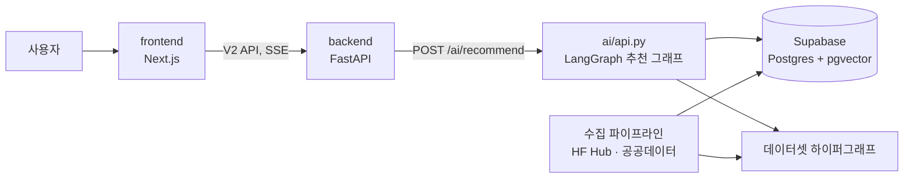

# Model Scout

만들고 싶은 서비스를 자연어로 말하면 한국어 지원 모델과 데이터셋(Hugging Face·공공데이터)을 근거와 함께 추천합니다.
확인되지 않은 정보는 추측해서 채우지 않고 "모름"으로 표시합니다.

## 무엇을 하나

> 밤늦게나 주말에 문 연 약국이랑 병원을 찾아주는 서비스를 만들고 싶어.

1. **아이디어 분해**: 필요한 AI 기능(taxonomy task)과 데이터 영역으로 나눕니다. 너무 모호하면 먼저 되묻습니다.
2. **모델 추천**: 한국어 지원 Hugging Face 모델에서 조건(크기, 라이선스, GPU 메모리 등)에 맞는 후보를 모델 카드 근거와 함께 보여줍니다.
3. **데이터셋 추천**: HF 데이터셋과 공공데이터(서울 열린데이터광장, 공공데이터포털)에서 서비스·학습용 데이터를 찾고 출처·형식·이용 조건을 안내합니다.
4. **라이선스 판단과 설명**: 모델·데이터 조합의 이용 조건을 규칙으로 판정하고, LLM이 검색된 결과만으로 답변을 씁니다. 결과에 대해 이어서 질문할 수 있습니다.

| 구분 | 상태 |
|---|---|
| 모델 추천 (근거, 계약 필드 기반 hard filter) | 구현됨 |
| 데이터셋 추천 (HF·공공데이터, 하이퍼그래프 검색) | 구현됨 |
| 웹 UI (추천 스트리밍, 되묻기, 근거 확인, 설명 질문, 대화 복원·공유) | 구현됨 |
| 공공데이터 코퍼스 v2 (중복 정제·검색 문서·공식 정보 보완) | 빌드·고정 완료, 운영 미전환 |
| 공공데이터 검색 개선 (pre-retrieval 실험) | 평가 기준 마련, 실험 진행 중 |

## 구조



추천 그래프(`ai/17_recommend_graph.py`): `decompose → clarify → search_models → search_datasets → assess → explain`.
경로가 항상 같아서 같은 입력이면 같은 검색 결과가 나오고, 골든셋 평가가 재현됩니다.

| 폴더 | 역할 | 스택 |
|---|---|---|
| [`frontend/`](frontend/) | 웹 UI · 내장 mock API ([README](frontend/README.md)) | Next.js 15, React 19, Tailwind 4, pnpm |
| [`backend/`](backend/) | 공개 API V2: 세션, 대화 이력, 설명 질문, 취소 처리 ([README](backend/README.md), [API 명세](backend/docs/02-api-v2.md)) | FastAPI (SSE) |
| [`ai/`](ai/) | 내부 추천 API, 수집·임베딩·검색 파이프라인, 추천 그래프, 평가 ([README](ai/README.md)) | Python 3.11, LangGraph |
| [`ai/contract/`](ai/contract/) | 모델 데이터 계약: 모델 한 건이 가져야 할 사실과 모를 때의 처리 ([README](ai/contract/README.md)) | JSON Schema |
| [`ai/test/`](ai/test/) | 모델·공공데이터 골든셋과 평가기 ([README](ai/test/README.md)) | pytest |
| [`deploy/`](deploy/) | VPS 배포 (Docker Compose: ai, backend, Caddy) | Docker |
| [`docs/`](docs/) | 기획 문서 ([`index.html`](docs/index.html)) | |

## 로컬 실행

**1. 환경 변수**

```bash
cp ai/.env.example ai/.env                    # Supabase, OpenAI 키 입력
cp frontend/.env.example frontend/.env.local  # 기본값: /api/mock (AI 없이 시연 데이터). 백엔드 연결 시 http://localhost:8000
```

**2. 백엔드** (`http://localhost:8000`)

```bash
python -m venv .venv
.venv\Scripts\activate            # macOS/Linux: source .venv/bin/activate
pip install -r backend/requirements.txt
cd backend && uvicorn app.main:app --reload --reload-dir app
```

백엔드의 DB 설정은 프로세스 환경변수로 전달합니다(`.env.example`은 참고용). 새 환경에서는 `backend/app_schema.sql`을 먼저 적용합니다.

**3. AI 내부 서버** (`http://localhost:8001`, 별도 터미널)

```bash
python ai/api.py
```

**4. 프론트엔드** (`http://localhost:3000`)

```bash
cd frontend && pnpm install && pnpm dev
```

프론트만 볼 때는 2·3번 없이 mock API(`NEXT_PUBLIC_API_URL=/api/mock`)로 실행됩니다.

## 데이터와 평가

- **모델 코퍼스**: HF Hub에서 수집 → 기술 metadata → semantic evidence → 임베딩 → Supabase 적재(Stage 1~4). 기준은 [`ai/README.md`](ai/README.md), 재수집 절차는 [`ai/MODEL_REINGEST_RUNBOOK.md`](ai/MODEL_REINGEST_RUNBOOK.md).
- **데이터 계약**: 파라미터 수·라이선스·GGUF 정보 등 계약 필드와 현재 충족률은 [`ai/contract/baseline.md`](ai/contract/baseline.md). 재수집은 계약 회귀가 있으면 멈춥니다.
- **모델 골든셋**: [`ai/test/golden/`](ai/test/golden/) (v2, 7유형 70개 질의).
- **공공데이터 골든셋**: [`ai/test/public_data/`](ai/test/public_data/). 기준 라벨은 `labels_llm_v5`, 기준 스냅샷은 코퍼스 v2 `documents_id 37026bd248c19ea0`입니다. 검색기 간 비교는 공통 평가기 `evaluate_public.py`로 합니다.
- **코퍼스 v2 전환 계획**: [`ai/test/public_data/corpus_v2/CUTOVER.md`](ai/test/public_data/corpus_v2/CUTOVER.md). v2 산출물 일부는 git에 없으므로 빌드한 사람의 폴더를 받아야 합니다.

## 자동화 (GitHub Actions)

| 워크플로 | 실행 | 내용 |
|---|---|---|
| `dataset-quality.yml` | push, PR | 데이터·추천 품질 검사 |
| `dataset-refresh.yml` | 매일 04:00 KST 재빌드, 월 02:30 KST 전체 수집 | 데이터셋 갱신 |
| `model-scout-incremental.yml` | 수동 | 변경된 모델 증분 동기화 |
| `model-scout-reingest.yml` | 수동 | 전체 재수집 (DB 용량·계약 검사 포함) |
| `wiki-pages.yml` | push, 수동 | LLM 위키를 GitHub Pages로 배포 |

## 폴더 간 규칙

- `ai/` 스크립트는 위치와 상관없이 데이터를 `ai/data/`에서 읽고 씁니다. 파이프라인 명령은 `ai/` 폴더에서 실행합니다.
- 데이터 파일 안에 저장된 경로(`data/readmes/...`)는 `ai/` 기준 상대 경로입니다.
- 백엔드는 내부 AI API `POST /ai/recommend`를 호출합니다. AI 서버가 추천 그래프와 검색용 파일을 로딩하므로 배포 시 해당 데이터를 AI 컨테이너에 포함해야 합니다.
- 공개 백엔드에는 OpenAI 키를 넣지 않습니다. LLM 호출은 모두 내부 AI API를 거칩니다.
- `ai/wiki/`(LLM 위키, Obsidian vault)는 git에 올리지 않습니다. `ai/`에서 `python 15_build_wiki.py`로 생성합니다.
- Docker(VPS 배포) 구성은 `deploy/compose.yml`과 서비스별 `Dockerfile`에 있습니다. 운영 적용 여부는 배포 환경에서 별도 확인합니다.
