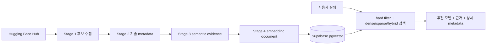

# Model Scout

Model Scout는 자연어로 적은 프로젝트 요구사항을 바탕으로 Hugging Face 모델을 찾고, 조건을 통과한 후보와 모델 카드 근거를 함께 제공하는 추천 데이터 파이프라인입니다. 한국어 지원 근거, task, 라이선스, 파라미터 수, context length, 양자화, 실행 환경, semantic claim과 benchmark 정보를 하나의 검색 문서로 결합합니다.

## 현재 상태

수량은 2026-09-28 snapshot 기준입니다.

- 추천 corpus는 Core 1,478개와 Low Popularity 2,128개, 총 3,606개입니다.
- Stage 1의 Likely 2,100개와 Fallback 14,244개는 참고 후보이며 Stage 2~4와 추천 검색 corpus에는 넣지 않습니다.
- Stage 4 임베딩은 `text-embedding-3-small`, 1,536차원입니다.
- Supabase에는 모델 검색 행과 Parent–Child evidence 행을 함께 적재합니다.
- Stage 1~4 생성 및 기본 검증을 완료했습니다.



## 파이프라인

| 단계 | 스크립트 | 역할 |
|---|---|---|
| 1 | `01_collect_models.py` | 9개 task의 후보 수집, 다운로드 tier, Korean evidence, canonical/variant grouping |
| 2 | `02_enrich_metadata.py` | config, tokenizer, artifact, license, parameter/context, quantization, runtime metadata |
| 3 | `03_generate_semantic_metadata.py` | README를 LLM으로 요약하고 장점·제한·용도·claim별 evidence를 생성 |
| 3 보조 | `03_repair_truncated_semantic.py`, `evidence_index.py` | 긴 README 보강과 Parent–Child evidence index 생성 |
| 4 | `04_build_embeddings.py` | 검색용 `embedding_text`와 1,536차원 임베딩 생성 |
| benchmark | `06_extract_benchmark_metadata.py` | README/model-index benchmark를 보수적으로 추출 |
| 동기화 | `08_sync_supabase.py` | schema 검증, 초기 적재, TTL 증분 처리, evidence backfill |
| 검색 검증 | `05_validate_retrieval.py` | 검색, hard filter, conflict penalty, evidence 회귀 검증 |

`07_integrate_benchmark_metadata.py`는 이전 수동 실행과의 호환용 래퍼입니다. 새 전체·증분 파이프라인에서는 `06_extract_benchmark_metadata.py`를 사용합니다. `benchmark_metadata.py`는 benchmark 추출 모듈이고 `task_conflict.py`는 별도 의존 파일로 사용하지 않습니다.

## Stage 1 수집 기준

대상 pipeline tag는 다음 9개입니다.

`text-generation`, `feature-extraction`, `sentence-similarity`, `text-classification`, `question-answering`, `summarization`, `translation`, `image-text-to-text`, `automatic-speech-recognition`

주요 설정은 `MIN_DOWNLOADS=80`, `CORE_DOWNLOADS=500`, `LIMIT_PER_TASK=None`, `CUTOFF_CONFIRMATION=10`입니다.

- Core: 다운로드 수 500 이상이며 `A_verified`인 후보
- Low Popularity: 다운로드 수 80~499이며 `A_verified`인 후보
- Likely: `B_likely` 참고 후보
- Fallback: `C_fallback` 참고 후보

`A_verified`는 Hub metadata, 언어 tag, 번역 pair, 모델명 근거를 조합한 수집 분류입니다. 이름 기반 근거는 metadata 기반 근거보다 약하므로 candidate type과 evidence strength를 별도로 보존합니다. 다운로드 수는 품질 점수가 아니라 오프라인 우선순위 신호입니다. canonical group과 variant는 중복 노출을 줄이는 데 사용하며, 원본 variant 정보는 보존합니다.

Stage 1은 지정한 9개 pipeline tag와 Hub API 응답 범위만 다룹니다. 다른 tag이거나 pipeline tag가 없는 모델은 자동으로 포함되지 않을 수 있습니다. 빈 API 응답, task 실패, 급격한 snapshot 감소는 fail-closed로 처리하며 기존 snapshot을 유지합니다.

## Stage 2 metadata

config, tokenizer config, artifact index, README에서 다음 필드를 추출합니다.

- task, language, architecture, base model, artifact와 model format
- license, parameter count, context length, quantization
- CPU, CUDA, MPS, vLLM, ONNX, llama.cpp의 문서·artifact 기반 runtime compatibility
- popularity, canonical lineage, source와 confidence

확인되지 않은 값은 `null` 또는 `unknown`으로 남깁니다. `runtime_compatibility`는 문서에서 확인한 실행 가능성 신호이며 실제 실행 성공을 보증하지 않습니다. parameter count와 context length도 source/confidence를 함께 확인해야 합니다.

## Stage 3 semantic evidence

`03_generate_semantic_metadata.py`는 README를 atomic evidence 단위로 나누고, LLM이 만든 각 claim에 `evidence_refs`와 `supporting_quote`를 연결합니다. section-aware 계층 정보와 Parent–Child 관계는 `evidence_index.py`가 deterministic하게 생성합니다. README가 없는 모델은 Core 4개, Low Popularity 6개이며 `no_source` metadata-only 상태로 보존합니다.

현재 README snapshot은 Core 1,474개, Low Popularity 2,122개입니다. 원본 snapshot에서 잘림이 남은 모델은 Core 7개, Low Popularity 12개입니다. 긴 README 보강은 Core 41개와 Low Popularity 84개에 수행했습니다. 잘림이나 README 부재가 있더라도 확인되지 않은 내용을 추측해 채우지 않습니다.

## Stage 4와 검색 문서

Stage 4는 모델 identity, task, language, 기술 metadata, runtime, popularity, Stage 3 semantic claim, benchmark projection을 `embedding_text`로 구성합니다. `--execute`에서만 임베딩 API를 호출하고, 증분 sync에서는 변경된 model ID만 처리합니다. DB에 동일한 `document_hash`가 있으면 기존 임베딩을 재사용합니다.

운영 검색 저장소는 Supabase pgvector입니다. 로컬 Stage 4 JSONL은 snapshot과 재현성을 위해 보관하지만, 검색 결과 상세 정보는 model row와 evidence row를 hydrate해서 제공합니다.

## Benchmark projection

`06_extract_benchmark_metadata.py`는 README와 `model-index`에서 dataset, metric, split, config, 점수, quote를 보수적으로 추출합니다.

- 숫자 없이 benchmark 이름만 있으면 `mentions`로 보존합니다.
- 모델명과 점수의 연결이 불명확하면 ranking signal로 사용하지 않습니다.
- architecture, parameter, context, quantization 표는 benchmark 점수로 분류하지 않습니다.
- 서로 다른 dataset, metric, split, config의 점수는 직접 비교하지 않습니다.
- README self-reported 수치는 오래됐거나 실험 조건이 다를 수 있으므로 hard filter나 모델 카드 근거를 대체하지 않습니다.

따라서 benchmark는 보조 순위 신호이며, 단독으로 추천을 결정하지 않습니다.

## Supabase와 TTL 자동화

스키마는 `supabase_schema.sql`, 적재와 검증은 `08_sync_supabase.py`가 담당합니다.

| 테이블 | 역할 |
|---|---|
| `model_scout_models` | 3,606개 모델의 compact metadata, Stage 2·3 상세 정보, benchmark projection, 1,536차원 vector |
| `model_scout_evidence` | Parent section, Child claim, supporting quote, evidence hash |
| `model_scout_sync_runs` | 초기 적재와 증분 sync 이력 |

최초 적재:

```bash
source ~/main/bin/activate
python 08_sync_supabase.py --ensure-schema
python 08_sync_supabase.py --initial --apply
```

최초 적재 뒤에는 전체 snapshot을 다시 올리지 않습니다. GitHub Actions 또는 수동 실행으로 변경 모델만 Stage 2~4와 benchmark projection을 거쳐 upsert합니다.

```bash
MODEL_SCOUT_TTL_HOURS=24 python 08_sync_supabase.py --refresh --apply
```

후보에서 탈락한 모델은 `active=false`로 비활성화합니다. `--force`는 전체 갱신이 아니라 TTL 검사만 건너뜁니다. 필요한 경우 다음 backfill을 사용합니다.

```bash
python 08_sync_supabase.py --backfill-runtime --apply
python 08_sync_supabase.py --backfill-search-metadata --apply
python 08_sync_supabase.py --backfill-evidence --apply
```

GitHub Actions에는 `HF_TOKEN`, `OPENAI_API_KEY`, `SUPABASE_DB_HOST`, `SUPABASE_DB_PORT`, `SUPABASE_DB_NAME`, `SUPABASE_DB_USER`, `SUPABASE_PASSWORD` secrets가 필요합니다. 성공한 sync만 snapshot과 benchmark fingerprint를 갱신하고, 실패한 run은 기존 snapshot과 DB row를 교체하지 않습니다.

## 검증

```bash
source ~/main/bin/activate
python 05_validate_retrieval.py --execute
python test/evaluate_retrieval_modes.py
python -m pytest -q --disable-warnings \
  test/test_stage1_collection.py \
  test/test_stage3_pool_reconciliation.py \
  test/test_benchmark_metadata.py \
  test/test_recommendation_quality.py
```

검증에서는 task, 한국어 조건, parameter/context, popularity, task conflict, canonical 중복, evidence reference와 supporting quote를 확인합니다. 추천 결과는 실제 모델 실행 성공이나 라이선스 법률 자문을 의미하지 않습니다.

## 운영상 남은 비용

정확성에 영향을 주는 미해결 오류는 없습니다. TTL 실행 때도 다음 deterministic 비용은 남아 있습니다.

1. benchmark fingerprint를 확인하기 위한 README snapshot 전체 1회 스캔
2. Parent–Child evidence index의 전체 JSONL 스캔
3. 원자적 snapshot 교체를 위한 Stage 2·3 JSONL 전체 읽기·쓰기

이 비용들은 LLM 재호출이나 임베딩 재생성이 아니라 파일 I/O입니다. 변경 feed나 별도 변경 인덱스를 도입할 때 줄일 수 있으며, 현재 자동화의 안전성을 위해 의도적으로 유지합니다.

## 주요 파일

- `README.md`: 프로젝트와 운영 개요
- `data/README.md`: snapshot 파일과 수량
- `test/README.md`: 골든셋과 검색 평가 방법
- `requirements.txt`: 수집·Stage 1~4 의존성
- `requirements_mcp.txt`: MCP/LangChain 선택 의존성
