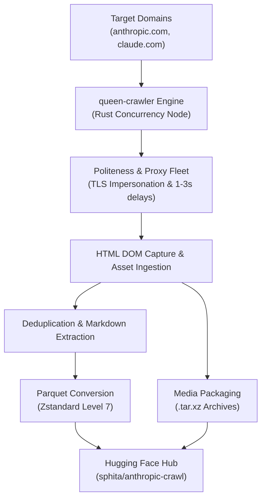

---
annotations_creators:
- no-annotation
language:
- en
- ru
- ja
- ko
- zh
- ar
license: gpl-3.0
task_categories:
- text-generation
- summarization
- question-answering
task_ids:
- language-modeling
size_categories:
- 1K<n<10K
tags:
- anthropic
- claude
- web-crawl
- ai-safety
- research
- frontier-models
- cl100k-tokens
- llm-pretraining
configs:
- config_name: default
  data_files: "2026-10-15/data/pages.parquet"
- config_name: pages-latest
  data_files: "2026-10-15/data/pages.parquet"
- config_name: assets-latest
  data_files: "2026-10-15/data/assets_metadata.parquet"
- config_name: errored-latest
  data_files: "2026-10-15/data/errored.parquet"
- config_name: pages-2026-09-29
  data_files: "2026-09-29/data/pages.parquet"
- config_name: assets-2026-09-29
  data_files: "2026-09-29/data/assets_metadata.parquet"
- config_name: errored-2026-09-29
  data_files: "2026-09-29/data/errored.parquet"
---

<div align="center">

# 🏛️ Anthropic Complete Web Corpus & Research Archive

**High-fidelity web crawl, untouched DOM HTML, full Markdown corpora, technical papers, safety frameworks, and complete media assets from Anthropic's public web estate.**

[](https://huggingface.co/datasets/sphita/anthropic-crawl)
[](https://www.gnu.org/licenses/gpl-3.0)
[](https://huggingface.co/datasets/sphita/anthropic-crawl/tree/main/2026-10-15)
[](https://huggingface.co/datasets/sphita/anthropic-crawl)
[](https://huggingface.co/datasets/sphita/anthropic-crawl)
[](https://github.com/sphita)
[](https://discord.gg/mz2hBN3k8p)

[Overview](#-overview--executive-summary) · [Snapshots](#-multi-snapshot-releases) · [Languages](#-language--multilingual-distribution) · [Token Statistics](#-comprehensive-corpus--token-statistics) · [Schema](#-dataset-schema) · [File Listing](#-complete-repository-file-listing) · [Quick Start](#-quick-start-examples) · [Crawler Engine](#-crawler-engine--pipeline-architecture)

</div>

---

## 📌 Overview & Executive Summary

The **Anthropic Complete Web Corpus & Research Archive** is a curated, high-fidelity archive capturing the entirety of Anthropic's public-facing digital footprint (`www.anthropic.com` and `claude.com`). Published by **[Sphita AI Research](https://huggingface.co/sphita)**, this dataset is designed for frontier AI safety research, web-agent grounding, language model pre-training, and longitudinal study of frontier model development.

Captured via Sphita's high-concurrency Rust crawler engine (`queen-crawler`), this archive preserves both the raw Server-Side Rendered (SSR) HTML DOM trees and structured, clean Markdown texts alongside all associated media assets (research PDFs, system cards, product diagrams, logos, audio, and presentation videos).

### Key Highlights
* **Dual-Corpus Representation**: Every crawled page includes both clean, structured Markdown and the original untouched HTML DOM.
* **Exact Token Auditing**: Fully profiled using OpenAI and Claude standard `cl100k_base` BPE tokenizer, measuring over **21.14 Million total tokens** in the latest release.
* **Frontier Safety & Model Documentation**: Exhaustive coverage of Claude model releases (Claude Mythos 5/5.1, Claude Fable 5/5.1, Claude Sonnet 5.5, Claude Opus 4.x/5, Claude Haiku), Responsible Scaling Policies (ASL-3 & ASL-4), and frontier threat intelligence reports.
* **Dense Media Archives**: Bundled into standalone, SHA256-verified `.tar.xz` archives with exact URL-to-asset mapping preserved in `assets_metadata.parquet`.

---

## 📅 Multi-Snapshot Releases

The dataset is partitioned into timestamped snapshot directories reflecting regular crawl intervals. Users can query the latest state or pin reproducible training pipelines to a historical snapshot.

| Snapshot Directory | Crawl Date | Status | Unique Pages | cl100k Tokens (MD / Total) | Media Assets | Parquet Corpus Size |
| :--- | :--- | :--- | :--- | :--- | :--- | :--- |
| **[`2026-10-15/`](https://huggingface.co/datasets/sphita/anthropic-crawl/tree/main/2026-10-15)** | `2026-10-15` | **Latest (Active)** | **528** | **3.27M** / **21.15M** | 4,518 files (16 archives, 1.72 GB) | 15.89 MB (Zstandard-7) |
| **[`2026-09-29/`](https://huggingface.co/datasets/sphita/anthropic-crawl/tree/main/2026-09-29)** | `2026-09-29` | Historical | **586** | ~3.30M / ~20.5M | 4,000+ files (19 archives, 2.30 GB) | 13.88 MB (Zstandard-7) |

---

## 🌐 Language & Multilingual Distribution

Languages and writing scripts are identified dynamically across DOM HTML attributes and Unicode script distributions:

| Language | ISO Code | Page Occurrences | Notes & Context |
| :--- | :--- | :--- | :--- |
| **English** | `en` | 528 pages (100.0%) | Primary language of corpus, technical papers, and web pages |
| **Russian** | `ru` | 3 pages (0.6%) | Threat intelligence research and multilingual crawler guidance |
| **Japanese** | `ja` | 3 pages (0.6%) | International events (e.g. Tokyo Builder Summit) and localized documentation |
| **Korean** | `ko` | 2 pages (0.4%) | Multilingual crawler opt-out and API guidance |
| **Chinese** | `zh` | 1 page (0.2%) | Threat intelligence indicators and localized articles |
| **Arabic** | `ar` | 1 page (0.2%) | Threat intelligence research and multilingual security indicators |

---

## 📊 Comprehensive Corpus & Token Statistics

*Token volume calculated with OpenAI / Claude `cl100k_base` BPE tokenizer against the latest snapshot (`2026-10-15`).*

| Metric | Markdown Text | Raw HTML DOM | Combined Payload |
| :--- | :--- | :--- | :--- |
| **Total Tokens (`cl100k_base`)** | **3,268,588** | **17,876,539** | **21,145,127** |
| **Total Words** | **1,487,597** | — | — |
| **Total Raw Character Size** | **13,600,469 chars** (12.97 MB) | **144,200,300 bytes** (137.52 MB) | **150.49 MB** |
| **Average Tokens per Page** | **6,190.5** tokens | **33,857.1** tokens | **40,047.6** tokens |
| **Median Tokens per Page** | **5,014** tokens | **31,805** tokens | — |
| **Parquet Size (Zstandard-7)** | — | — | **15.89 MB** |
| **Columnar Compression Ratio** | — | — | **9.47x reduction** |

---

## 🗂️ Category & Section Breakdown

The dataset covers all major domains of Anthropic's web presence, categorized by primary URL routes:

| Section Route | Pages | Markdown Words | cl100k Tokens | % of Corpus | Subject Matter & Content Scope |
| :--- | :--- | :--- | :--- | :--- | :--- |
| `/news` | 182 | 343,704 | 765,025 | 23.4% | Model launches, product updates, system cards, partnerships |
| `/research` | 114 | 392,805 | 752,924 | 23.0% | Frontier AI alignment, mechanistic interpretability, safety |
| `/legal` | 43 | 169,873 | 282,700 | 8.6% | Terms of service, privacy policies, Responsible Scaling Policy (RSP) |
| `/events` | 34 | 64,760 | 245,026 | 7.5% | Industry webinars, AI safety symposiums, developer sessions |
| `/resources` | 31 | 46,478 | 147,651 | 4.5% | Enterprise deployment guides, developer prompts, whitepapers |
| `/engineering` | 26 | 82,148 | 154,714 | 4.7% | Cluster infrastructure, distributed systems, internal tooling |
| `/customers` | 10 | 16,892 | 51,119 | 1.6% | Case studies, production customer stories |
| `/careers` | 8 | 63,014 | 199,312 | 6.1% | Technical competencies, research roles, organization structure |
| `/solutions` | 8 | 20,139 | 57,032 | 1.7% | Enterprise offerings, specialized industry workflows |
| `/beneficial-deployments` | 5 | 15,600 | 35,440 | 1.1% | AI for science, public interest projects, non-profit initiatives |

---

## 🏆 Landmark Publications & Longest Documents

The corpus preserves critical foundational papers and regulatory filings in unclipped form:

| Document Title | Section | Words | cl100k Tokens | Canonical Target URL |
| :--- | :--- | :--- | :--- | :--- |
| **Countering Misuse of AI (Threat Intelligence)** | `/threat-intelligence-report` | 38,206 | 59,484 | `https://www.anthropic.com/threat-intelligence-report-september-2026` |
| **Claude’s Constitution** | `/constitution` | 30,802 | 38,373 | `https://www.anthropic.com/constitution` |
| **Anthropic Transparency Hub** | `/transparency` | 23,732 | 38,363 | `https://www.anthropic.com/transparency` |
| **Frontier Model Transparency Report** | `/transparency/model-report` | 23,732 | 38,363 | `https://www.anthropic.com/transparency/model-report` |
| **Does Anthropic Crawl Data From The Web And How Can Site Owners Block The Crawler** | `/en/articles` | 4,665 | 36,052 | `https://support.claude.com/en/articles/8896518-does-anthropic-crawl-data-from-the-web-and-how-can-site-owners-block-the-crawler` |
| **How Can I Access The Claude API** | `/en/articles` | 4,180 | 34,151 | `https://support.claude.com/en/articles/8114521-how-can-i-access-the-claude-api` |
| **Research & Engineering Career Competencies** | `/careers/jobs` | 8,744 | 27,865 | `https://www.anthropic.com/careers/jobs` |

---

## 🤖 Frontier Models & Safety Index

Index of tracked model generations, safety standards, and operational frameworks:

| Frontier Model / Concept | Mentions | Architectural Significance |
| :--- | :--- | :--- |
| **Claude Opus (4.5 / 4.6 / 4.8 / 5)** | **1,494** | Deep cognitive reasoning, complex math, multi-step planning |
| **Claude Fable (5 & 5.1)** | **790** | Specialized agentic software engineering and theorem proving |
| **Claude Mythos (5 & 5.1)** | **679** | High-assurance cybersecurity analysis and computational biology |
| **Claude Haiku (4.5 & 5.5)** | **251** | Ultra-low latency edge inferencing and compact processing |
| **Claude Sonnet 5.5** | **213** | Balanced frontier capabilities and coding throughput |
| **ASL-3 & ASL-4 (RSP Levels)** | **147** | AI Safety Level containment standards & autonomous threat mitigations |
| **Enterprise Frontier Safeguards (EFS)** | **59** | Customer tenant isolation and cryptographic verification |

---

## 📦 Media Archives Breakdown

All embedded assets discovered across the crawl were downloaded, deduplicated, and packaged into compressed `.tar.xz` archives:

| Media Category | File Count | Archive Files | Total Size |
| :--- | :--- | :--- | :--- |
| **Visual Assets (Images / Badges / Diagrams)** | 2,998 files | 12 `.tar.xz` archives | 951.46 MB |
| **Documents (PDF Papers / Technical Reports)** | 269 files | 2 `.tar.xz` archives | 676.88 MB |
| **Video Assets (Demos / Keynotes)** | 58 files | 1 `.tar.xz` archive | 90.66 MB |
| **Audio Assets (Audio Clips / Recordings)** | 1 file | 1 `.tar.xz` archive | 0.59 MB |
| **Total Media Volume** | **4,518 assets** | **16 archives** | **1,719.5 MB** |

---

## 🗃️ Dataset Schema

The primary data files are stored in Apache Parquet format with Zstandard (level 7) compression.

### 1. `data/pages.parquet` (Main Text Corpus)
| Column Name | Apache Arrow Type | Description |
| :--- | :--- | :--- |
| `url` | `string` | Canonical URL of the web page |
| `title` | `string` | Extracted HTML title header |
| `markdown` | `string` | High-fidelity extracted markdown body text |
| `html` | `string` | Complete raw HTML DOM delivered by Server-Side Rendering |
| `word_count` | `int64` | Word count of the markdown content |
| `char_count` | `int64` | Character count of the markdown content |
| `links` | `list<string>` | Complete array of outbound hyperlinks discovered on the page |
| `assets` | `list<struct<url, asset_type>>` | All embedded media tags (images, videos, PDFs) linked on this page |

### 2. `data/assets_metadata.parquet` (Media Catalog)
| Column Name | Apache Arrow Type | Description |
| :--- | :--- | :--- |
| `source_url` | `string` | Webpage URL where the asset was discovered |
| `asset_url` | `string` | Absolute URL of the asset |
| `asset_type` | `string` | Category: `image`, `document`, `video`, or `audio` |
| `is_downloaded` | `bool` | Whether the asset was successfully fetched |
| `local_filename` | `string` | Path inside the respective `.tar.xz` archive |
| `file_size_bytes` | `int64` | Size of the asset file in bytes |
| `extension` | `string` | File format (`.pdf`, `.png`, `.webp`, `.svg`, `.mp4`, etc.) |

### 3. `data/errored.parquet` (Crawler Telemetry)
| Column Name | Apache Arrow Type | Description |
| :--- | :--- | :--- |
| `url` | `string` | Target URL that encountered an exception |
| `error` | `string` | HTTP error code or parser failure detail |
| `timestamp` | `int64` | Epoch timestamp of failure |
| `is_permanent` | `bool` | Whether failure was 404/permanent or transient |

---

## 📁 Complete Repository File Listing

The repository contains the following structured hierarchy across both releases:

```
sphita/anthropic-crawl/
├── .gitattributes
├── README.md                                          # Master Dataset Card & Documentation
│
├── 2026-10-15/                                        # [LATEST RELEASE]
│   ├── README.md                                      # Snapshot-specific Dataset Card (11.28 KB)
│   ├── SHA256SUMS.txt                                 # Cryptographic checksum manifest (2.46 KB)
│   ├── data/
│   │   ├── pages.parquet                              # 528 crawled pages (15.89 MB)
│   │   ├── assets_metadata.parquet                    # 4,518 asset catalog records (0.87 MB)
│   │   └── errored.parquet                            # 127 crawler dropout logs (4.0 KB)
│   ├── metadata/
│   │   ├── head.json                                  # Crawler execution telemetry (pages, bytes, timing)
│   │   ├── manifest.json                              # Stream manifest configuration
│   │   ├── config.json                                # Engine configuration (seeds, depth, rate limits)
│   │   └── discovered_subdomains.txt                  # Discovered endpoints (www.anthropic.com)
│   └── media_archives/
│       ├── audio/
│       │   └── Audio_loose.tar.xz                     # Audio assets (0.59 MB)
│       ├── documents/
│       │   ├── Document_1792067320.tar.xz             # Research papers & legal filings (211.84 MB)
│       │   └── Document_loose.tar.xz                  # General documents & whitepapers (465.04 MB)
│       ├── images/
│       │   ├── Image_1792067478.tar.xz                (40.16 MB)
│       │   ├── Image_1792067580.tar.xz                (42.88 MB)
│       │   ├── Image_1792067654.tar.xz                (46.80 MB)
│       │   ├── Image_1792067742.tar.xz                (49.65 MB)
│       │   ├── Image_1792067810.tar.xz                (55.06 MB)
│       │   ├── Image_1792067963.tar.xz                (82.80 MB)
│       │   ├── Image_1792068099.tar.xz                (91.24 MB)
│       │   ├── Image_1792068203.tar.xz                (99.98 MB)
│       │   ├── Image_1792068330.tar.xz                (104.58 MB)
│       │   ├── Image_1792068447.tar.xz                (109.31 MB)
│       │   ├── Image_1792068544.tar.xz                (111.36 MB)
│       │   └── Image_loose.tar.xz                     (117.54 MB)
│       └── videos/
│           └── Video_loose.tar.xz                     # Product demonstrations & keynotes (90.66 MB)
│
└── 2026-09-29/                                        # [HISTORICAL RELEASE]
    ├── README.md                                      # 2026-09-29 Dataset Card (3.19 KB)
    ├── SHA256SUMS.txt                                 # Cryptographic checksum manifest
    ├── data/
    │   ├── pages.parquet                              # 586 crawled pages (13.88 MB)
    │   ├── assets_metadata.parquet                    # Media catalog (0.77 MB)
    │   └── errored.parquet                            # Error logs (4.0 KB)
    ├── metadata/
    │   ├── head.json
    │   ├── manifest.json
    │   ├── config.json
    │   └── discovered_subdomains.txt
    └── media_archives/
        ├── audio/
        │   └── Audio_loose.tar.xz                     # Audio assets (0.59 MB)
        ├── documents/
        │   ├── Document_1790688970.tar.xz             (168.21 MB)
        │   └── Document_loose.tar.xz                  (537.82 MB)
        ├── images/                                    # 17 image archives (.tar.xz, ~1.48 GB total)
        └── videos/
            └── Video_loose.tar.xz                     (337.40 MB)
```

---

## 🚀 Quick Start Examples

### 1. Load via Hugging Face `datasets` (Python)

```python
from datasets import load_dataset

# 1. Load the latest default snapshot (2026-10-15 pages corpus)
pages = load_dataset("sphita/anthropic-crawl")
print(f"Loaded {len(pages['train'])} pages.")
print("Sample Title:", pages['train'][0]['title'])
print("Sample URL:", pages['train'][0]['url'])

# 2. Load with streaming (zero RAM overhead)
streaming_pages = load_dataset("sphita/anthropic-crawl", split="train", streaming=True)
first_page = next(iter(streaming_pages))
print("First stream page length:", len(first_page['markdown']))

# 3. Load historical snapshot (2026-09-29)
hist_pages = load_dataset("sphita/anthropic-crawl", "pages-2026-09-29")
print(f"Historical pages: {len(hist_pages['train'])}")

# 4. Filter research papers
research = pages['train'].filter(lambda x: "/research/" in x['url'])
print(f"Total Research Publications: {len(research)}")
```

### 2. Instant SQL over Parquet with DuckDB

You can run direct SQL analytics against remote or local Parquet files without ingesting into a database:

```sql
-- Top 5 longest research papers by markdown word count
SELECT 
    title, 
    word_count, 
    url 
FROM '2026-10-15/data/pages.parquet' 
WHERE url LIKE '%/research/%' 
ORDER BY word_count DESC 
LIMIT 5;

-- Count total assets categorized by extension
SELECT 
    extension, 
    count(*) AS total_files, 
    sum(file_size_bytes) / (1024 * 1024) AS total_mb
FROM '2026-10-15/data/assets_metadata.parquet'
GROUP BY extension
ORDER BY total_files DESC;
```

### 3. Load with Pandas & PyArrow (Zero-Bloat Column Projection)

```python
import pyarrow.parquet as pq

# Load only necessary metadata columns into memory
table = pq.read_table(
    "2026-10-15/data/pages.parquet", 
    columns=["url", "title", "word_count", "char_count"]
)
df = table.to_pandas()
print(df.sort_values(by="word_count", ascending=False).head(10))
```

### 4. Download via Hugging Face CLI (`hf`)

```bash
# Download only the latest 2026-10-15 parquet data files
~/.venv/bin/hf download sphita/anthropic-crawl \
  --repo-type dataset \
  --include "2026-10-15/data/*" \
  --local-dir ./anthropic-crawl-data

# Download all research PDFs and documents
~/.venv/bin/hf download sphita/anthropic-crawl \
  --repo-type dataset \
  --include "2026-10-15/media_archives/documents/*" \
  --local-dir ./anthropic-docs
```

### 5. Extracting Media Archives

```bash
# Extract all downloaded research PDFs
mkdir -p ./unpacked_documents
tar -xf 2026-10-15/media_archives/documents/Document_loose.tar.xz -C ./unpacked_documents/

# Extract audio archive
mkdir -p ./unpacked_audio
tar -xf 2026-10-15/media_archives/audio/Audio_loose.tar.xz -C ./unpacked_audio/

# Extract visual assets
mkdir -p ./unpacked_images
tar -xf 2026-10-15/media_archives/images/Image_loose.tar.xz -C ./unpacked_images/
```

---

## ⚙️ Crawler Engine & Pipeline Architecture



* **Crawler Engine**: `queen-crawler` — custom multi-threaded Rust crawler node with async runtime.
* **Network & Security**: Dynamic rotating proxy pool, Cloudflare TLS fingerprint preservation, and domain-scoped polite delays (1.0s – 3.0s).
* **DOM Transformation**: High-precision HTML5 parser with automated layout normalization, extracting clean Markdown while preserving original SSR HTML payloads.
* **Storage Compression**: Columnar Apache Parquet with Zstandard level 7 compression for high read throughput and 9.47x compression factor.

---

## 🔒 Cryptographic Verification

All files published in each release are cataloged with SHA-256 hashes to guarantee data integrity against transport corruption or tampering.

To verify a downloaded snapshot:

```bash
cd 2026-10-15
sha256sum -c SHA256SUMS.txt
```

---

## 📜 License

This dataset is published under the **GNU General Public License v3.0 (GPL-3.0)**.  
The scraped HTML and Markdown contents remain subject to Anthropic's public terms and copyright where applicable.

---

## 🌐 Sphita Research Collective & Leadership

**Sphita** is an open-first AI collective dedicated to engineering datasets, advancing agentic reasoning, and providing high-fidelity infrastructure for the open-source community.

* **Lead & Creator**: **[Adhyansh Verma](https://huggingface.co/AdhyanshVerma)** ([GitHub: @AVadhyanshverma](https://github.com/AVadhyanshverma))
* **Organization Hugging Face**: [huggingface.co/sphita](https://huggingface.co/sphita)
* **Organization GitHub**: [github.com/sphita](https://github.com/sphita)
* **Discord Community**: [Join the Sphita Server](https://discord.gg/mz2hBN3k8p)
* **Profile & Hub Space**: [sphita/README](https://huggingface.co/spaces/sphita/README)
