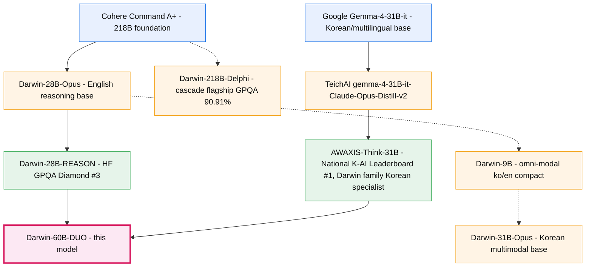

> ### 📱 Run it on your phone or a GPU-less PC → **POCKET**  ·  🚀 **[Try it live (CPU chat)](https://huggingface.co/spaces/FINAL-Bench/POCKET-35B-CPU)**
> VIDRAFT's on-device family: a 35B model that runs on **iPhone** and on **CPU with no GPU** — stock `llama.cpp`, no fork.
>
> [](https://huggingface.co/spaces/FINAL-Bench/POCKET-35B-CPU) [](https://huggingface.co/collections/FINAL-Bench/pocket-models-6a618ee5d23eafb7e185a5c6) [](https://huggingface.co/FINAL-Bench/POCKET-35B-GGUF) [](https://huggingface.co/FINAL-Bench/POCKET-KR-MLX) [](https://huggingface.co/FINAL-Bench/POCKET-EN-GGUF)

>


<p align="center">
  
</p>

<p align="center">
  <a href="https://huggingface.co/FINAL-Bench/Darwin-60B-DUO"></a>
</p>

<p align="center">
  <a href="https://huggingface.co/FINAL-Bench/Darwin-28B-REASON"></a>
  <a href="https://huggingface.co/Anserwise/AWAXIS-Think-31B"></a>
</p>

# Darwin-60B-DUO

> The Darwin family's first **DUO** model — two domain-verified SOTA models served as a single OpenAI-compatible endpoint.
>
> ## 🏆 GPQA Diamond (full 198 questions): **88.38%**
> Darwin-28B-REASON single 69.70 % · AWAXIS-Think-31B single 77.27 % · first cascade 83.84 % · **Darwin-DELPHI DUO 88.38 %**

Darwin-60B-DUO unifies two specialist models from the Darwin family behind a single API:

- **Darwin-28B-REASON** — Hugging Face leaderboard **GPQA Diamond rank #3**, English graduate-level reasoning specialist.
- **AWAXIS-Think-31B** — National **K-AI Leaderboard rank #1** (operated by the Ministry of Science and ICT of the Republic of Korea), Korean specialist.

A Hybrid-A router automatically dispatches each request to the optimal strategy (single route / sequential collaboration / ensemble), so callers see one model and one endpoint while internally benefiting from both specialists.

---

## Model Description

Darwin-60B-DUO is a **gateway-orchestrated aggregate** of two constituent base models. The repository contains a FastAPI orchestrator, configuration, and Docker Compose recipe. The model weights themselves live in the constituent repositories and are loaded at runtime by two vLLM backends.

| Component | Source | Architecture | Parameters | Verified Rank |
|-----------|--------|--------------|-----------:|---------------|
| English reasoning specialist | [FINAL-Bench/Darwin-28B-REASON](https://huggingface.co/FINAL-Bench/Darwin-28B-REASON) | Qwen3.5 multimodal | 26.9 B | HF GPQA Diamond #3 |
| Korean specialist (Darwin family, Gemma-4 branch) | [Anserwise/AWAXIS-Think-31B](https://huggingface.co/Anserwise/AWAXIS-Think-31B) | Gemma-4 multimodal | 31.27 B | National K-AI Leaderboard #1 |
| Aggregate | This repository (`FINAL-Bench/Darwin-60B-DUO`) | DUO orchestrator | **58.17 B** | — |

> **Note on AWAXIS membership.** AWAXIS-Think-31B is also part of the Darwin family — it is the Korean specialist branch distilled by the Darwin team on top of Google's Gemma-4 base, complementing the original Qwen3.5-line Darwin lineage as the family's second axis.

### Hybrid-A Orchestration

The gateway analyzes each incoming request and selects one of five strategies. The default distribution observed on representative traffic is:

| Strategy | When it fires | Backends called | Cost vs. single 30 B | Share |
|----------|---------------|-----------------|---------------------:|------:|
| `route_awaxis` | Korean-dominant input | AWAXIS only | 1× | ~50 % |
| `route_darwin` | English-dominant input | Darwin only | 1× | ~20 % |
| `split_refine` | Korean output requiring rigorous English / STEM reasoning | Darwin (draft) → AWAXIS (polish) | 2× | ~15 % |
| `split_refine_reverse` | English output requiring Korean cultural / linguistic context | AWAXIS (draft) → Darwin (polish) | 2× | ~5 % |
| `ensemble_v1` | Short-answer / multiple-choice queries | Both backends with self-consistency + cross-verification tournament | 2× | ~10 % |

Average effective cost is approximately **1.3× a single 30 B model** — 70 % of traffic is served by a single backend; the remaining 30 % uses both.

---

## Intended Use

### Primary use cases

- **Bilingual Korean-English assistants** that require both Korean fluency and high-quality English reasoning.
- **Single-endpoint integration** where downstream tooling already targets the OpenAI Chat Completions API (LangChain, LlamaIndex, OpenAI SDK, Continue, Cursor, etc.).
- **Cost-conscious deployment** — most traffic is served by a single backend at 1× cost while difficult cross-domain queries automatically receive a 2× collaboration.

### Out-of-scope

- **Vision / video generation.** Both constituent models are text-mode only as deployed here (`--limit-mm-per-prompt {"image":0,"video":0}`).
- **Real-time streaming.** Initial gateway release does not stream token-by-token. Streaming is planned for v1.1.
- **Direct `AutoModel.from_pretrained()` loading.** This repository contains an orchestrator, not unified weights. Use the gateway or Docker Compose.
- **Safety-critical decision making** (medical diagnosis, legal advice, autonomous control). LLM hallucinations apply.

---

## How to Use

### Option A — Docker Compose (recommended)

```bash
git clone https://huggingface.co/FINAL-Bench/Darwin-60B-DUO
cd Darwin-60B-DUO

# HF token is needed only to download constituent weights on first launch
export HF_TOKEN=hf_xxx
docker compose -f docker/docker-compose.yml up -d

# Verify
curl http://localhost:8000/v1/models
# {"object":"list","data":[{"id":"darwin-60b-duo",...}]}
```

### Option B — Manual launch (2 × B200 / H100, FP8)

```bash
# Clone the repo (includes both constituent weights, ~120GB LFS)
git lfs install
git clone https://huggingface.co/FINAL-Bench/Darwin-60B-DUO
cd Darwin-60B-DUO

# 1. Darwin-28B-REASON on GPU 0 (from local subfolder)
CUDA_VISIBLE_DEVICES=0 VLLM_DP_MASTER_PORT=45011 \
  vllm serve ./darwin-28r \
    --port 8021 --served-model-name darwin-28r \
    --quantization fp8 --enforce-eager \
    --limit-mm-per-prompt '{"image":0,"video":0}' &

# 2. AWAXIS-Think-31B on GPU 1 (from local subfolder)
CUDA_VISIBLE_DEVICES=1 VLLM_DP_MASTER_PORT=45012 \
  vllm serve ./awaxis-31b \
    --port 8022 --served-model-name awaxis-31b \
    --quantization fp8 --enforce-eager \
    --limit-mm-per-prompt '{"image":0,"video":0}' &

# 3. Gateway
pip install -r gateway/requirements.txt
python gateway/server.py --port 8000 \
    --darwin-url http://127.0.0.1:8021/v1 \
    --awaxis-url http://127.0.0.1:8022/v1
```

> **No external HF download.** Both weights are inside this repo (`./darwin-28r`, `./awaxis-31b`), so vLLM serves directly from local LFS without re-downloading from upstream repos.

> **Single-GPU collocation.** With FP8 quantization the combined footprint is ~30 GB. Set both backends to `CUDA_VISIBLE_DEVICES=0` and `--gpu-memory-utilization 0.45` to colocate on a single 80 GB B200 / H100.

### OpenAI-compatible call

```python
from openai import OpenAI

client = OpenAI(base_url="http://localhost:8000/v1", api_key="anything")

# The router picks split_refine (Korean output with English/STEM reasoning)
resp = client.chat.completions.create(
    model="darwin-60b-duo",
    messages=[{
        "role": "user",
        "content": "Explain the practical difference between GPT-5 and Claude's reasoning, in Korean.",
    }],
)
print(resp.choices[0].message.content)
# Darwin produces the English reasoning; AWAXIS polishes it into natural Korean.
```

You can also force a specific strategy via the non-standard `duo_strategy` field:

```python
resp = client.chat.completions.create(
    model="darwin-60b-duo",
    messages=[{"role":"user","content":"Which is correct? (A) ... (B) ..."}],
    extra_body={"duo_strategy": "ensemble_v1"},  # force MAJ@8 + cross-verify
)
```

Inspect the chosen strategy in the response under `_duo_route`:

```json
{
  "choices": [{"message": {"role":"assistant", "content":"..."}}],
  "_duo_route": {
    "strategy": "split_refine",
    "reason": "korean_output_with_english_reasoning",
    "elapsed_s": 4.83,
    "language_ratio": 0.42
  }
}
```

---

## 🛠️ Build Your Own DUO (the gateway is model-agnostic)

The `gateway/` in this repo is **not specific to Darwin and AWAXIS** — it is a general, Apache-2.0 orchestrator that fuses **any two OpenAI-compatible backends** into a single endpoint. We're open-sourcing it because the pattern is broadly useful, and we'd love to see what the community builds.

### The core idea in one sentence

> Two small specialists, automatically routed, beat one big generalist on cost **and** quality — and the user only ever sees a single model.

### Pair anything

You don't need our models. Point the gateway at *your* favourite two and you have a DUO in minutes:

| Pair | Why it works |
|------|--------------|
| reasoning model + multilingual model | rigorous logic, fluent output (what we did) |
| fast small model + slow accurate model | cheap on easy queries, escalate only hard ones |
| code model + general chat model | route by "is this code?" |
| English specialist + your-language specialist | localize without losing reasoning depth |

### Adapt in 2 steps

```bash
# Step 1 — point at your two backends (any vLLM / TGI / OpenAI-compatible server)
python gateway/server.py --port 8000 \
    --darwin-url http://your-model-A:8000/v1 \
    --awaxis-url http://your-model-B:8000/v1
```

```python
# Step 2 — teach the router when to use which model (gateway/router.py)
def select_strategy(text):
    if is_code(text):        return "route_model_a"   # send code to the code model
    if is_korean(text):      return "route_model_b"   # send Korean to the KO model
    if is_mcq(text):         return "ensemble_v1"      # short-answer → both + pick
    if needs_polish(text):   return "split_refine"     # draft with A, polish with B
    return "route_model_b"                             # sensible default
```

That's it. The gateway handles the OpenAI API surface, parallel calls, response merging, and `_duo_route` transparency for you.

### What's included vs. what's proprietary

- ✅ **Open (Apache-2.0):** the gateway — router, single-route, sequential-refine, and a baseline ensemble. Enough to build a fully working DUO of your own.
- 🔒 **Proprietary (Darwin-DELPHI):** the test-time engine and prompt recipes that push *this* DUO to **88.38 % on GPQA Diamond** (above the naive oracle ceiling). The open gateway gives you the architecture; the leaderboard score is ours.

### Extend it

- **DUO → TRIO → N-way:** add a third backend and a third route; the merge logic generalizes.
- **Smarter routing:** swap the keyword heuristics in `router.py` for a tiny learned classifier.
- **New strategies:** contribute your own (debate, best-of-N, tool-use) via PR.

> **Fork it, point it at your models, and tell us what you built.** Open a discussion on the Community tab — good routing recipes and new backend pairings are exactly the kind of thing we want to feature.

---

## Darwin Family

Darwin-60B-DUO sits at the confluence of two complete lineages — the **Qwen3.5-based Darwin lineage** (English reasoning) and the **Gemma-4-based Darwin Korean-specialist branch (AWAXIS)**. The full family tree, with both constituent ancestries fully expanded:



### Plain-text fallback

```
Darwin Family

Lineage A — English reasoning (Qwen3.5-line)
└── Cohere Command A+ (218B foundation)
    └── Darwin-28B-Opus (English reasoning base)
        └── Darwin-28B-REASON  🥉  ← HF GPQA Diamond #3
                                     (English reasoning specialist)
    │
    │   Related Darwin parents in this lineage:
    │   • Darwin-218B-Delphi  (cascade flagship, GPQA Diamond 90.91 %)
    │   • Darwin-9B           (omni-modal ko/en compact)
    │   • Darwin-31B-Opus     (Korean multimodal base)

Lineage B — Korean specialist (Gemma-4-line)
└── Google Gemma-4-31B-it (Korean / multilingual base)
    └── TeichAI gemma-4-31B-it-Claude-Opus-Distill-v2
        └── AWAXIS-Think-31B  🥇  ← National K-AI Leaderboard #1
                                     (Darwin family Korean specialist)

         │                             │
         └──────── DUO unification ────┘
                          ↓
              ⭐ Darwin-60B-DUO ⭐  ← THIS MODEL
              "Two SOTAs, one OpenAI-compatible endpoint."
```

> The HF **Model tree** widget (right sidebar) automatically renders the upstream chain from each `base_model` declared in the YAML frontmatter, so the full ancestry — Cohere Command A+ and Google Gemma-4-31B-it at the roots — is browsable directly on this page.

---

## Operation Modes

### Mode 1 — Route (single backend, ~70 % of traffic)

The router selects one backend based on language ratio and lightweight keyword heuristics:

- `korean_ratio(prompt) > 0.3` → AWAXIS
- ASCII / code / math markers (`def `, `import`, `\boxed`, `prove`, …) → Darwin
- Mixed → AWAXIS (Korean-first default)

### Mode 2 — Split / Refine (sequential collaboration, ~20 % of traffic)

One model drafts, the other polishes. The polish instruction is language-adaptive:

```
User: "Explain entropy intuitively in Korean."

Step 1 — Darwin (rigorous English reasoning)
        "Entropy quantifies the number of microstates compatible
         with a given macrostate, representing disorder ..."

Step 2 — AWAXIS (natural Korean polish)
        "엔트로피는 쉽게 말하면 '무질서함의 정도'입니다.
         같은 모습으로 보이지만 사실 그 안에 ..."
```

The reverse path (`AWAXIS draft → Darwin polish`) fires when the output language is English but the prompt requires Korean cultural or linguistic context.

### Mode 3 — Ensemble V₁ Tournament (~10 % of traffic)

For multiple-choice and short-answer queries, both backends produce **N = 8 samples** at temperature 0.7. Each backend's answer is its own majority vote (self-consistency). If the two majorities agree → return. If they disagree → each backend verifies the pair (cross-verification), and the tournament winner is selected. A confidence tiebreaker (own-vote count) resolves split verdicts.

---

## Repository Layout

```
Darwin-60B-DUO/
├── README.md                  ← this model card
├── image.png                  ← cover image
├── config.json                ← DUO configuration & orchestration metadata
├── tokenizer_info.json        ← constituent tokenizer references
├── LICENSE                    ← Gemma + Apache-2.0 dual notice
├── darwin-28r/                ← Darwin-28B-REASON full weights + tokenizer + config (~54GB)
│   ├── config.json
│   ├── tokenizer.json
│   ├── chat_template.jinja
│   ├── model.safetensors.index.json
│   └── model-00001-of-00012.safetensors ... model-00012-of-00012.safetensors
├── awaxis-31b/                ← AWAXIS-Think-31B full weights + tokenizer + config (~62.5GB)
│   ├── config.json
│   ├── tokenizer.json
│   ├── chat_template.jinja
│   ├── model.safetensors.index.json
│   └── model-00001-of-00002.safetensors ... model-00002-of-00002.safetensors
├── gateway/
│   ├── server.py              ← FastAPI OpenAI-compatible orchestrator
│   ├── router.py              ← language / domain / MCQ classifier
│   ├── refine.py              ← sequential refine (drafter → polisher)
│   ├── ensemble.py            ← V₁ MAJ@N + cross-verification
│   └── requirements.txt
├── docker/
│   └── docker-compose.yml     ← vLLM ×2 + gateway integrated launcher
└── benchmarks/
    ├── README.md              ← full evaluation results
    ├── cascade_v4_32k.json    ← cascade v4 raw data
    ├── recovery_v5.json       ← recovery v5 raw data
    └── poe_v6.json            ← POE v6 raw data (latest)
```

> **Self-contained:** all model weights (both constituents) are included in this repository — `git clone` once and you have everything. Total LFS payload: **~120GB**.

---

## Evaluation

### Verified constituent scores

| Constituent | Benchmark | Rank |
|-------------|-----------|------|
| Darwin-28B-REASON | Hugging Face GPQA Diamond | **#3** |
| AWAXIS-Think-31B  | National K-AI Leaderboard (Republic of Korea, MSIT) | **#1** |

### Darwin-60B-DUO aggregate

| Benchmark | Status |
|-----------|--------|
| GPQA Diamond (full 198 questions) | **88.38%** (175/198) — see `benchmarks/` |
| KMMLU | TBA |
| CLIcK (Korean cultural reasoning) | TBA |
| Helmet / Ruler (long context) | TBA |
| Needle-in-Haystack 32 K / 128 K | NIAH 32 K: 5/5 per backend (sanity, single model only) — full DUO numbers TBA |

> Aggregate DUO benchmark results will be published in `benchmarks/` after formal evaluation. The verified constituent ranks above are independent third-party measurements and are not aggregate DUO scores.

### Cost / latency notes

- **Route mode:** comparable to a single 30 B FP8 backend (1× latency, 1× compute).
- **Split mode:** ~2× latency (two sequential generations).
- **Ensemble V₁:** ~2× compute (parallel) plus a short cross-verify round when majorities disagree.

---

## Bias, Risks, and Limitations

- **Hallucination.** Standard LLM caveats apply. Both backends can produce confident but incorrect outputs, especially on out-of-distribution queries.
- **Disagreement bias.** Empirically, the V₁ tournament occasionally selects a wrong answer that both backends collectively favor over a single backend's correct one. The gateway exposes the routing decision in `_duo_route` for auditability.
- **Language coverage.** Best performance on English and Korean. Other languages fall back to the closer-fit backend without explicit optimization.
- **Combined weights are not bundled.** The aggregator pulls each backend's weights from the constituent repositories. Network and disk for both is required.
- **Two-GPU baseline.** BF16 deployment requires two GPUs. FP8 quantization enables single-GPU operation on B200 / H100 (80 GB).
- **Training data cut-off.** Darwin-28B-REASON: ~ 2026-Q1. AWAXIS-Think-31B: ~ 2026-Q1.

---

## License

Darwin-60B-DUO inherits the **Gemma Terms of Use** as its effective combined license — the more restrictive of the two constituent licenses.

| Constituent | License |
|-------------|---------|
| Darwin-28B-REASON | Apache-2.0 |
| AWAXIS-Think-31B  | Gemma (inherited from Gemma-4) |
| **Darwin-60B-DUO (aggregate)** | **Gemma** (combined-license inheritance) |

The orchestrator code (`gateway/`, `docker/`) is offered under Apache-2.0 to maximize developer flexibility; combined-license inheritance applies to served model behavior only.

Please review the [Gemma Terms of Use](https://ai.google.dev/gemma/terms) and the [Gemma Prohibited Use Policy](https://ai.google.dev/gemma/prohibited_use_policy) before commercial deployment.

---

## Acknowledgments

- **FINAL-Bench team** — Darwin family architecture and DUO concept
- **Anserwise Korean specialist team** — AWAXIS-Think-31B development
- **VIDRAFT** — orchestration framework and the Hybrid-A routing strategy
- **Google DeepMind** — Gemma-4 foundation
- **Cohere and Qwen teams** — Command A+ / Qwen3.5 foundation lineage

---

## Contact

- Hugging Face org: [FINAL-Bench](https://huggingface.co/FINAL-Bench)
- Sister orgs: [Anserwise](https://huggingface.co/Anserwise) · [VIDraft](https://huggingface.co/VIDraft)
- Issues and discussions: please open a thread on the **Community** tab of this repository.

---

## Citation

```bibtex
@misc{darwin60b-duo-2026,
  title  = {Darwin-60B-DUO: A single-endpoint DUO of an English-reasoning SOTA
            and a Korean SOTA via Hybrid-A orchestration},
  author = {FINAL-Bench Team and Anserwise Team and VIDRAFT},
  year   = {2026},
  howpublished = {Hugging Face},
  url    = {https://huggingface.co/FINAL-Bench/Darwin-60B-DUO}
}
```
