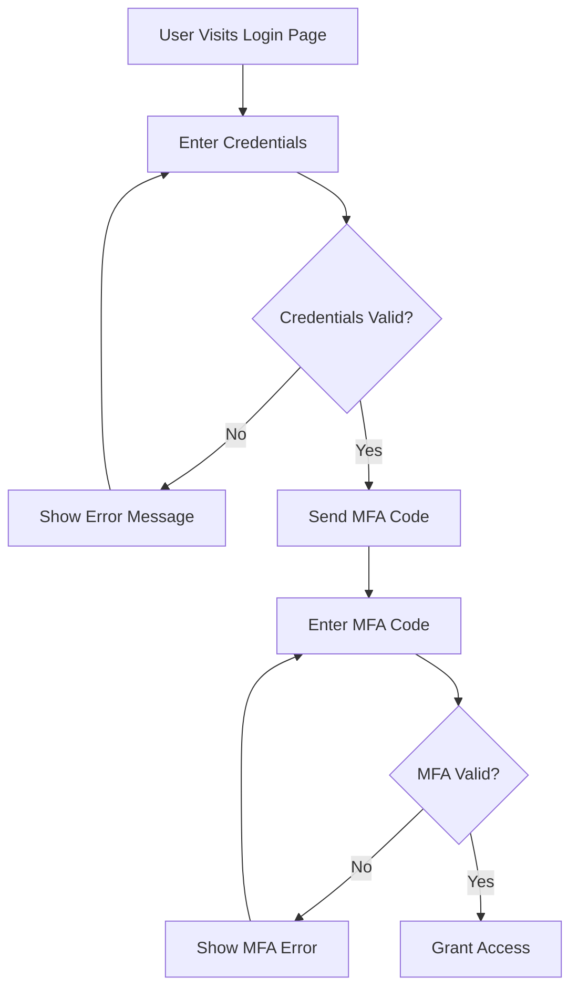

# Charty-1B — GGUF

Quantized [GGUF](https://github.com/ggml-org/ggml/blob/master/docs/gguf.md) versions of **Charty-1B**, a compact text-to-Mermaid diagram generation model fine-tuned from [LFM2.5-1.2B-Instruct](https://huggingface.co/unsloth/LFM2.5-1.2B-Instruct). Designed for **on-device, mobile, and CPU-only inference**.

> For the original 16-bit safetensors, see [ali-thowfeek/Charty-1B](https://huggingface.co/ali-thowfeek/Charty-1B).

## 📦 Available Quantizations

| File | Quantization | Size (approx.) | Quality | Best For |
|---|---|---|---|---|
| `Charty-1B-F16.gguf` | F16 (full) | ~2.3 GB | ★★★★★ Maximum | GPU inference, maximum fidelity |
| `Charty-1B-Q8_0.gguf` | Q8_0 | ~1.2 GB | ★★★★☆ Near-lossless | Balanced CPU / edge deployment |
| `Charty-1B-Q4_K_M.gguf` | Q4_K_M | ~0.7 GB | ★★★☆☆ Good | Mobile phones, low-RAM devices. See demo: [Charty-1B-Q4_K_M running on mobile phone](https://www.linkedin.com/posts/ali-ahamed-thowfeek_finetuned-an-llm-and-ran-it-on-my-phone-activity-7487933675423309825-maBc) |

## 🗒️ Model Details

| Field | Value |
|---|---|
| Base model | unsloth/LFM2.5-1.2B-Instruct |
| Architecture | LFM2 (hybrid: 10 double-gated LIV convolution blocks + 6 GQA attention blocks) |
| Parameters | 1.17B |
| Context length | 32,768 tokens |
| Vocabulary size | 65,536 |
| Fine-tuning method | LoRA (SFT) via Unsloth + Hugging Face TRL |
| Training dataset | ali-thowfeek/text-to-mermaid (3,837 examples) |
| Developed by | ali-thowfeek |

## 💬 Chat Template (Unsloth's Fixed Template)

This model ships with Unsloth's fixed Jinja chat template embedded in the GGUF versions and is applied automatically by llama.cpp with --jinja.

## 🎯 Intended Use

Generate Mermaid diagram syntax (flowcharts, sequence, class, state, ER, Gantt, pie, git graphs, mindmaps, quadrant charts, …) from plain-text prompts.
Run on low-end hardware: mobile phones, edge devices, laptops, embedded systems.
Power apps that need offline, private, diagram-as-code generation.

### What it does

Input (user prompt):
```
Create a flowchart showing the user login process with MFA verification.
```

Output (model response):

The model outputs only the Mermaid syntax code. No wrapping text, no  mermaid  fences.

## 🏃 Inference

Recommended Generation Parameters

| Parameter | Value |
|---|---|
| temperature | 0.1 |
| top_k | 50 |
| top_p | 0.1 |
| repetition_penalty | 1.05 |

## 📊 Training Details

| Detail | Value |
|---|---|
| Framework | Unsloth + Hugging Face TRL |
| Method | LoRA Supervised Fine-Tuning (SFT), merged into full weights |
| Dataset | ali-thowfeek/text-to-mermaid |
| Dataset size | 3,837 examples |
| Dataset source | Derived from Celiadraw/text-to-mermaid-2, cleaned, reworded, and validated against Mermaid v11 (core) |
| Validation | 100% of training examples produce valid Mermaid v11 core syntax |
| Output format | Raw Mermaid syntax only (no markdown fences, no explanations) |

## 📜 License

This model is a derivative work of [LFM2.5-1.2B-Instruct](https://huggingface.co/LiquidAI/LFM2.5-1.2B-Instruct) by Liquid AI and is released under the **[LFM Open License v1.0](https://huggingface.co/LiquidAI/LFM2.5-1.2B-Instruct/blob/main/LICENSE)**.

Key terms:
- ✅ Free for research, personal, and non-commercial use.
- ✅ Commercial use permitted for entities with **< $10M annual revenue**.
- ❌ Commercial use by entities with **≥ $10M annual revenue** is **not** licensed.
- You must include a copy of the [LICENSE](../../blob/main/LICENSE) with any redistribution.
- You must retain all copyright and attribution notices.

See the full [LICENSE](../../blob/main/LICENSE) file in this repository for complete terms.

## 📚 Citation

If you use this model, please cite the base model and this work:

```bibtex
@article{liquidai2025lfm2,
  title   = {LFM2 Technical Report},
  author  = {Liquid AI},
  journal = {arXiv preprint arXiv:2511.23404},
  year    = {2025}
}

@misc{thowfeek2026charty,
  title  = {Charty-1B: A Text-to-Mermaid Diagram Generation Model},
  author = {ali-thowfeek},
  year   = {2026},
  url    = {https://huggingface.co/ali-thowfeek/Charty-1B}
}
```

## 🙏 Acknowledgements

- [Liquid AI](https://www.liquid.ai/) — LFM2.5 base model
- [Unsloth](https://github.com/unslothai/unsloth) — 2× faster fine-tuning framework
- [Celiadraw](https://huggingface.co/Celiadraw) — Original text-to-mermaid dataset source
- [Hugging Face](https://huggingface.co/) — TRL library and model hosting